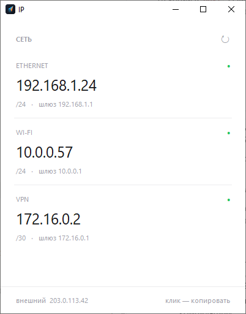

# IPInfo 1.10.1

Файл: `IPInfo.exe` — один файл, установка не нужна.

Показывает сетевые адаптеры компьютера и проверяет сеть и корпоративный VPN (Континент, OpenConnect): помогает понять, упал ли туннель сам или под ним пропал интернет, и почему к ПК не подключиться по RDP.



*На скриншоте вымышленные адреса.*

## Что умеет

- Список адаптеров: Ethernet, Wi-Fi, VPN-туннели, виртуальные. Отключённые Ethernet и Wi-Fi тоже видны («не подключён»).
- Для каждого: IP-адрес, маска, шлюз, DNS, MTU, скорость. Адрес 169.254.x.x (DHCP не выдал адрес) выделяется красным, VPN-адаптер подписан.
- Внешний IP — адрес, под которым компьютер виден в интернете.
- Клик по адаптеру копирует его IP в буфер обмена.
- `F5` или `↻` — обновить, `Esc` — скрыть панель или закрыть программу.
- **ИНФО**, **ПРОВЕРКА**, **МОНИТОРИНГ** и **FIX** открываются панелью, которая выезжает справа от списка адаптеров (вкладки переключаются, «скрыть ›» убирает панель).
- При запуске exe снимает с себя отметку «загружено из интернета» (Zone.Identifier): предупреждение «Не удалось проверить издателя» появляется только при самом первом запуске.
- **FIX**: кнопка **RDP-FIX** записывает `HKLM\Software\Microsoft\Terminal Server Client` `RemoteDesktop_SuppressWhenMinimized = 2` (REG_DWORD): сеанс RDP остаётся активным, когда окно свёрнуто. **RDP_Fix_del** удаляет параметр - стандартное поведение. Нужны права администратора (Windows покажет запрос); после изменения переподключите RDP.
- **ИНФОРМАЦИЯ** обновляется каждые 2 секунды: подключён ли VPN и какой (Континент, OpenConnect), к какому адресу сервера (в том числе через прокси Happ/sing-box), включён ли другой VPN, внутренний IP туннеля, локальный IP и шлюз, внешний IP (раз в минуту и при смене VPN), есть ли подключение RDP и сколько оно длится, по какому протоколу идёт RDP: UDP или TCP (по журналу клиента RDP, а без него - по UDP-сокету клиента), входящий RDP к этому ПК.
- **СОБРАТЬ ОТЧЁТ** — одна кнопка для пользователя: проверка, zip-архив и читаемый отчёт `.html` в папке отчётов; папка открывается с выделенным файлом, в окне написано, что отправить администратору.
- Пока программа открыта, мониторинг работает сам (`[report] autostart`), его журнал и последняя проверка сразу пишутся в папку отчётов: `Документы\IPInfo отчёты` (или `[report] folder`).

## Проверка сети и VPN

Кнопка «ПРОВЕРКА» в окне или `IPInfo.exe --check` в консоли. Проверки идут параллельно и занимают обычно 5–20 секунд.

| Раздел | Что проверяется |
|---|---|
| Локальная сеть | активный адаптер, адрес от DHCP, шлюз, ping роутера, Wi-Fi (сеть, сигнал, канал), конфликт домашней сети 10.x с корпоративной, включённые другие VPN (Happ/sing-box, WireGuard, Amnezia и др.), виртуальные адаптеры отмечаются как не влияющие на связь |
| Интернет | ping контрольных адресов, DNS, внешний IP |
| VPN-серверы | для каждого сервера из настроек: все адреса, которые отдаёт DNS (у имени может быть несколько IP), и для каждого адреса — открыт ли порт, ping и потери, MTU; к какому из адресов реально подключён клиент (по TCP-соединению, через локальный прокси вроде Happ/sing-box или по отдельному маршруту к серверу); TLS-проверка каждого адреса: версия TLS, на кого выдан сертификат и кем; предупреждение, если сертификат выдан не на имя сервера или адреса отвечают по-разному |
| Туннель | установлен ли и исправен ли виртуальный адаптер Континента/OpenConnect в диспетчере устройств (отключён, ошибка драйвера, «адаптер Континент 4 не найден»); есть ли адаптер с адресом 10.x и какой это клиент; через какой адаптер реально уходят пакеты к внутренним адресам; ping и MTU внутренних адресов; счётчики трафика туннеля (уходит, но не возвращается) |
| RDP | открыт ли порт RDP на серверах из `[rdp] targets` и через какой адаптер идёт подключение; по желанию (`incoming = yes`) — готовность самого ПК принимать RDP |

В конце — итог простыми словами, например «Туннель Континент поднят, но трафик к внутренней сети уходит мимо него: конфликт адресов с локальной сетью пользователя».

## Мониторинг обрывов

Кнопка «МОНИТОРИНГ» в окне или `IPInfo.exe --monitor` в консоли. Запустите перед работой по RDP и сверните окно.

- Каждые 2 секунды параллельно пингуются роутер, интернет, внутренние адреса туннеля (или DNS туннеля) и RDP-серверы из `[rdp] targets`; раз в 30 секунд проверяется порт RDP.
- Отслеживаются пропадание туннеля и смена его адреса, смена адреса и шлюза, переключение Wi-Fi между точками и слабый сигнал, включение и выключение другого VPN, ошибки на адаптере туннеля, сон компьютера. Раз в 30 с имя VPN-сервера заново разрешается через DNS: в журнал попадает смена списка адресов и переключение клиента на другой адрес сервера.
- Из журнала клиента RDP (mstsc) берутся отключения с кодом причины. На каждое отключение пишется разбор: что было со связью в последние 30 секунд перед ним, например «Сеть, интернет и туннель работали: обрыв на стороне RDP».
- В журнал попадают только изменения: `%LOCALAPPDATA%\IPInfo\logs\monitor-<дата>.log` и `.jsonl`. При остановке пишется итог: потери и время без связи по каждому узлу.

Обычная проверка тоже показывает обрывы RDP за последние сутки по журналу клиента.

## Настройки: ipinfo.ini

Файл `ipinfo.ini` лежит рядом с `IPInfo.exe`. Если его нет, программа создаст пример при первой проверке. Раздавайте пользователям exe вместе с готовым `ipinfo.ini`.

```ini
[vpn]
; адрес:порт/протокол, сколько угодно строк; все проверяются одновременно
continent_main = vpn1.example.ru:443/tcp
continent_res  = vpn2.example.ru:443/tcp
openconnect    = oc.example.ru:443/tcp

[internal]
; адреса, доступные только через туннель
dc   = 10.0.0.1
mail = 10.0.5.20

[internet]
targets = 1.1.1.1, 8.8.8.8, ya.ru

[tunnel]
network = 10.0.0.0/8
continent = Continent, Континент, Код Безопасности, Security Code, ZTN
openconnect = OpenConnect, Wintun, TAP-Windows
; посторонние VPN, о которых нужно предупреждать
other = sing-tun, happ, WireGuard, Amnezia, Clash, v2ray, Xray, Hiddify

[rdp]
; RDP-серверы, к которым подключаются с этого ПК через туннель
targets = 10.20.10.5, ts.corp.local:3389
; проверять ли входящий RDP на этот ПК
incoming = no

[logs]
; журналы VPN-клиентов для отчёта (папка, файл или маска)
continent = %ProgramData%\Security Code\Continent\*.log
```

Пути в `[logs]` — пример: укажите те, где журналы лежат у вашей версии клиента.

## Журналы и отчёт

- Журнал программы и результаты всех проверок: `%LOCALAPPDATA%\IPInfo\logs` (`ipinfo.log` и `checks.jsonl`, одна строка JSON на проверку).
- Папка отчётов (`Документы\IPInfo отчёты`): `Мониторинг <дата>.txt` (пишется, пока программа открыта), `Последняя проверка.html`, `Отчёт <ПК> <дата>.zip` и рядом `.html` с тем же именем.
- Срок хранения: `[report] keep_days` (по умолчанию 30 дней). Журналы мониторинга, отчёты и записи истории проверок старше этого срока удаляются при запуске программы и раз в 6 часов, пока она открыта; `0` — не удалять. Удаляются только файлы, которые создаёт сама программа; `Последняя проверка.html` и чужие файлы в папке не трогаются. Журнал программы `ipinfo.log` ограничен размером (до 6 МБ).
- `Отчёт.html` внутри zip и рядом с ним — для человека: итог простыми словами, что пропадало по мониторингу, все проверки с отметками «норма / внимание / ошибка», адаптеры.
- Отчёт из консоли (`--report`): `%LOCALAPPDATA%\IPInfo\reports\ipinfo-<ПК>-<дата>.zip`.
- В отчёте: итог и все проверки (`report.txt`, `report.json`), журналы программы, `ipconfig /all`, `route print`, `netsh wlan show interfaces`, прокси, `netstat -ano`, `arp -a`, журнал клиента RDP за 3 дня, `ipinfo.ini` и журналы VPN-клиентов из `[logs]`.

## Ключи командной строки

```
IPInfo.exe --check            проверка в консоли
IPInfo.exe --report           проверка и zip-отчёт
IPInfo.exe --monitor          мониторинг обрывов до Ctrl+C (--interval 2)
IPInfo.exe --check --json     проверка в JSON
IPInfo.exe --cli              адаптеры в консоли
IPInfo.exe --json             адаптеры в JSON
IPInfo.exe --config F         другой файл настроек
IPInfo.exe --all              показать все адаптеры, включая выключенные
IPInfo.exe --no-net           не запрашивать внешний IP
```

Консольные ключи работают из `cmd` или PowerShell: вывод появляется в том же окне.

## Системные требования

- Windows 10 или Windows 11, 64-bit.
- Права администратора не нужны.
- Python и другие программы не нужны.

Windows 7, 8 и 32-битные системы не поддерживаются.

## Как запустить

1. Скопируйте `IPInfo.exe` в любую папку или на рабочий стол.
2. Запустите двойным кликом.

Копируйте на другие ПК сам `IPInfo.exe`, а не ярлык на него: ярлык ссылается на путь с вашего компьютера и на чужом не сработает.

### Если появилось окно «Windows защитила ваш компьютер»

Это SmartScreen. Он предупреждает о любой программе без цифровой подписи, это не обнаружение вируса.

Нажмите **«Подробнее»**, затем **«Выполнить в любом случае»**. На этом компьютере окно больше не появится.

## Сетевые обращения

Локальные адреса программа получает из Windows, без выхода в интернет.

Чтобы узнать внешний IP, программа делает один HTTPS-запрос при запуске и при каждом обновлении. Запасные сервисы используются, только если первый не ответил:

1. `https://api.ipify.org`
2. `https://ifconfig.me/ip`
3. `https://icanhazip.com`

Проверка дополнительно обращается только к адресам из `ipinfo.ini` (ping, разрешение имени, TCP-подключение к порту). Никакие данные с компьютера не передаются: отчёт сохраняется локально, и пользователь отправляет его сам. Если доступ к этим адресам закрыт, внешний IP покажется как «нет связи», остальное работает.

Если запущен VPN, внешним IP будет адрес VPN-сервера, а не провайдера.

Запуск без обращения в интернет:

```
IPInfo.exe --no-net
```

## Проверка подлинности файла

SHA-256 каждой версии лежит рядом с exe на странице релиза: файл `IPInfo.exe.sha256.txt`.

Проверка в PowerShell:

```
Get-FileHash .\IPInfo.exe -Algorithm SHA256
```

Если хэш не совпадает, файл повреждён или изменён. Не запускайте его.

## Известные ограничения

- Нет цифровой подписи, поэтому при первом запуске появляется предупреждение SmartScreen (см. выше).
- Отдельные антивирусы могут ошибочно реагировать на программы, собранные PyInstaller. Windows Defender файл проверил — угроз нет.
- Если иконка отображается неправильно, это кэш иконок Windows. Сбросить его: `ie4uinit.exe -show`.

## Сборка из исходников

Нужны Windows 10/11 x64 и Python 3.10 или новее. Выпуск 1.0.0 собран на Python 3.14.7 и PyInstaller 6.22.2.

Тесты (запускаются и на Linux):

```
python -m unittest discover tests
```

Файлы в одной папке:

| Файл | Назначение |
|---|---|
| `ipinfo.py` | точка входа и окно |
| `netdiag\` | сбор данных, проверки, отчёт |
| `ip-icon.ico` | иконка программы |
| `version.txt` | версия и описание, которые видны в свойствах exe |

Установить PyInstaller (один раз):

```
python -m pip install pyinstaller
```

Собрать (запускать из папки с файлами):

```
python -m PyInstaller --onefile --windowed --noupx --clean --noconfirm --name IPInfo --icon ip-icon.ico --add-data "ip-icon.ico:." --version-file version.txt --exclude-module numpy --exclude-module pandas --exclude-module PIL --exclude-module unittest --exclude-module pydoc --exclude-module doctest ipinfo.py
```

Готовый файл появится в `dist\IPInfo.exe`. Папку `build` и файл `IPInfo.spec` можно удалить.

Что делают ключи:

- `--onefile` — один exe вместо папки с файлами.
- `--windowed` — без консольного окна.
- `--noupx` — не сжимать exe упаковщиком UPX. Сжатые файлы чаще принимают за вирус.
- `--add-data "ip-icon.ico:."` — положить иконку внутрь exe для заголовка окна. `--icon` отвечает только за значок файла.
- `--version-file` — версия и описание в свойствах файла.
- `--exclude-module` — не включать ненужные модули, чтобы уменьшить размер.

Модули `email` и `xml` исключать нельзя: через них работает запрос внешнего IP. Папку `netdiag` PyInstaller подхватывает сам.

Для новой версии поменяйте номер в `version.txt` в четырёх местах: `filevers`, `prodvers`, `FileVersion`, `ProductVersion`.

Каждая сборка даёт exe с другим SHA-256, даже из того же кода. После сборки посчитайте хэш заново и обновите раздел «Проверка подлинности файла».

## Изменения в 1.10.1

- Срок хранения журналов и отчётов: `[report] keep_days` в `ipinfo.ini` (по умолчанию 30 дней, 0 — не удалять). Старые журналы мониторинга, отчёты и записи истории проверок удаляются автоматически.

## Изменения в 1.10.0

- Окно: панель справа с вкладками ИНФОРМАЦИЯ, ПРОВЕРКА, МОНИТОРИНГ и FIX; кнопка «СОБРАТЬ ОТЧЁТ» делает проверку, zip-архив и читаемый отчёт `.html` в папке отчётов.
- ИНФОРМАЦИЯ в реальном времени: состояние и тип VPN, адрес сервера, другой VPN, внутренний, локальный и внешний IP, подключение RDP и его протокол (UDP или TCP).
- FIX: кнопки RDP-FIX и RDP_Fix_del для параметра `RemoteDesktop_SuppressWhenMinimized`.
- Мониторинг запускается сам при открытии программы и пишет журнал в папку отчётов.
- Предупреждение об издателе показывается только при первом запуске: программа снимает с себя отметку «загружено из интернета».

- Проверка сети и VPN (Континент, OpenConnect) с итоговым выводом; настройки в `ipinfo.ini`.
- Проверки случая «VPN подключён, адрес получен, связи нет»: маршруты, конфликт сети 10.x, счётчики трафика туннеля, MTU.
- Проверка RDP-серверов, к которым подключаются через туннель; проверка входящего RDP на ПК по желанию.
- Проверка виртуального адаптера VPN-клиента в диспетчере устройств: не найден, отключён, ошибка драйвера.
- Учёт другого VPN (Happ/sing-box и т.п.): показывается, через какой адаптер реально идут проверки, и отдельно — если подключение к VPN-серверу идёт через другой VPN.
- Если внутренние адреса не заданы, проверяются DNS-серверы туннеля.
- Мониторинг обрывов с разбором каждого отключения RDP по журналу клиента RDP.
- Каждый цикл мониторинга видны TCP-соединения клиента RDP (mstsc и др.): точное время закрытия. Разбор отключения RDP: время события, длительность сеанса, разрыв UDP-канала, адаптер, через который идёт трафик, проблемы сети за весь сеанс; для кода 2308 при «тихой» сети - подсказка про обрыв по неактивности. Если после события отключения соединение с RDP-сервером открыто (например, код 263 при входе), это не считается обрывом: в журнале пишется «сеанс продолжается».
- Обрыв RDP и блокировка удалённого ПК: в разборе каждого обрыва видно, сколько перед ним не было ввода на этом ПК; если обрывы повторяются после одинакового простоя, мониторинг подсказывает, что это таймер. На ПК, к которому подключаются по RDP, проверка показывает его таймеры (блокировка по простою, заставка с блокировкой, сон, лимиты простоя и длительности сеанса RDP, keep-alive) и сопоставляет за сутки блокировку, заставку и сон с отключениями сеанса RDP и их кодом причины. Мониторинг на этом ПК пишет блокировку, сон и отключение сеанса в журнал сразу. Журнал блокировок (Security) читается только при запуске от имени администратора.
- VPN-сервер с несколькими IP: проверка каждого адреса, к какому подключён клиент, в мониторинге — смена ответа DNS и адреса подключения.
- TLS-проверка каждого адреса VPN-сервера: ошибка вроде «tlsv1 alert protocol version» у клиента обычно значит, что на этом адресе отвечает не тот сервер или соединение перехватывается по пути.
- Клиент VPN, который ходит через локальный прокси (127.0.0.1): адреса сервера берутся из соединений прокси.
- Профили Континента: список серверов доступа по порядку (клиент подключается к первому, к следующему - после исчерпания попыток). Предупреждение о системном прокси Windows: Континент с автоопределением прокси пойдёт к серверу через него.
- Пароли и секреты Континента не читаются: поля с паролями, ключами и логинами отбрасываются при разборе json, файлы настроек и профилей в отчёт не попадают (только копия VPNConfig.json без таких полей), файлы с «password», «key» и т.п. в имени не открываются.
- Клиент Континента находится сам: папка установки, серверы из его настроек (VPNConfig.json) проверяются наравне с [vpn], его настройки и журналы попадают в отчёт, в окне проверки есть ссылка на утилиту диагностики Континента (LogCollector).
- Адрес подключения ищется по процессу VPN-клиента, с временем открытия соединения (видно, к какому IP он подключился первым). В мониторинге каждые 2 с видны попытки подключения клиента: какой адрес он пробовал, какой не ответил и к какому подключился.
- Журнал программы, история проверок и zip-отчёт.
- В окне видны DNS, MTU, скорость, отключённые адаптеры и адрес 169.254.x.x.
- Ключи `--cli` и `--json` теперь работают в собранном exe.
- Ошибки больше не закрывают программу молча: они пишутся в журнал и показываются.

## Изменения в 1.0.0

Первый выпуск.
